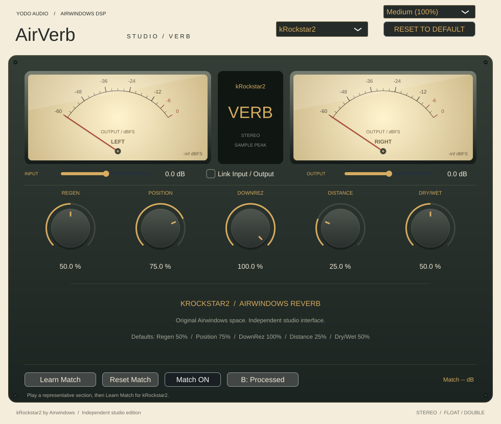

# AirVerb Studio

A studio interface for **Airwindows kRockstar2 (default) and kRockstar**, following
[AirEq](https://github.com/johandoornenbal/AirEq) and
[AirComp](https://github.com/johandoornenbal/AirComp): cream, charcoal and brass,
analogue output meters, linked trims and learned LUFS compensation.

Native **VST3 for Apple Silicon Macs, M2 and later**, macOS 11+. Original DSP by
Chris Johnson / Airwindows. Both native algorithms retain their audio calculations,
including the reverb feedback, room tone, downsampling, distance and dry/wet mixing.



[kRockstar editor](docs/ui-krockstar.png)

## Controls

| Algorithm | Controls, left to right | Native defaults |
| --- | --- | --- |
| kRockstar2 | Regen, Position, DownRez, Distance, Dry/Wet | 50%, 75%, 100%, 25%, 50% |
| kRockstar | Regen, Position, DownRez, Dry/Wet | 50%, 100%, 100%, 50% |

Position and Distance expand the original abbreviated labels. All native
parameters retain their 0–1 mappings, displayed as percentages. Regen is not a
seconds readout and DownRez is not a Hz readout. Double-click a knob to reset it,
or type a percentage below it. Dry/Wet at 100% suits a send/return effect.

Each algorithm has an independent automatable bank, input/output trims,
Link Input / Output, learned match, Match ON/OFF and Original/Processed setting.
The DAW session saves these plus the selected algorithm and UI size.
Choose Small (75%), Medium (100%) or Large (125%). Reset to Default restores
only the selected model's native controls, trims and link; Reset Match clears
only its learned compensation. Existing reverb history is reset on entering an
algorithm or preparing playback; switch at a quiet point to avoid abrupt tail changes.

## Trims and meters

Input and Output trims are wrapper gains from −24 to +24 dB. They default to
0 dB and use short ramps. Optional linking preserves the sum of trim gains in dB
during editor gestures, with balanced host automation gestures. It does not
change native reverb parameters. Double-click trims for unity.

The meters show final left/right sample peaks in dBFS, after reverb, output trim,
LUFS matching and A/B. They have a damped needle with an approximately 120 ms
response and return to rest when audio stops. These are output meters, appropriate
for the reverb signal. They are not gain-reduction meters or calibrated VU meters.
No limiter or extra gain normalization is added.

## LUFS comparison and compensation

1. Play a representative section, allowing the reverb to settle.
2. Click **Learn Match**, then **Finish Learning** after at least three seconds
   of accepted audio. Learning completes automatically at fifteen accepted seconds.
3. **Match ON** applies the learned fixed compensation; **Match OFF** disables it.
4. Compare **A: Original** with **B: Processed** using the short crossfade.

The applied adjustment is displayed in dB, with measured input and processed LUFS
underneath. Analysis uses stereo BS.1770 K-weighting, 400 ms windows, 100 ms
steps and integrated absolute/relative gating. Silent input does not count toward
learning. Compensation is bounded to ±24 dB; the UI reports when limited. Failed,
silent or canceled learning preserves the last successful match.

Analysis compares original input before wrapper Input trim with the native output
after Output trim, before compensation and A/B. Compensation is applied once to
the processed path, with a short ramp. Relearning measures uncompensated output.
The adjustment remains fixed until you learn again; it is not automatic gain riding.
Relearn after changing controls, trims or source material. For a send, learn with
representative audio reaching that send; a wet return and the dry source have
different envelopes, so judge the resulting balance by ear.

Original A/B returns untouched input and keeps the reverb running internally, so
returning to Processed retains its current tail. Host bypass returns untouched
input and suspends native processing and learning. Neither algorithm reports a
fixed latency. Native room-tone generation and regeneration have no fixed silence
cutoff, so the VST3 reports an unlimited tail; choose the desired tail duration
when exporting offline. Delay-buffer history is not serialized in sessions.

## One-command Mac build and install

Install Xcode Command Line Tools and CMake 3.22+, then run from a native Apple
Silicon terminal:

```sh
git clone https://github.com/johandoornenbal/AirVerb.git
cd AirVerb
bash scripts/build-sign-install-mac.sh
```

The script configures arm64 Release, builds the VST3, runs tests, stages and
ad-hoc signs the bundle, verifies it, then installs to:

```text
~/Library/Audio/Plug-Ins/VST3/AirVerb Studio.vst3
```

Close your DAW before installing; reopen or rescan afterwards. The existing installation is preserved until signing and verification succeed,
then backed up during replacement with rollback if replacement fails.
`AIRVERB_BUILD_DIR` and `AIRVERB_INSTALL_DIR` override the directories. Extra CMake
configure arguments can follow the script command, for example
`-DJUCE_PATH=/path/to/JUCE`. JUCE 8.0.12 is fetched at a pinned commit by default.

To install an already-built bundle:

```sh
bash scripts/build-sign-install-mac.sh --install-only '/path/to/AirVerb Studio.vst3'
```

GitHub Actions uses the same arm64 build/test/sign pattern and archives
`AirVerb-Studio-macOS-arm64.zip`. Ad-hoc signing is local signing, not Apple
notarization. Mac playback and native signing need validation on the target Mac.

## Development checks

Standalone DSP and loudness checks:

```sh
cmake -S . -B build-dsp -DAIRVERB_DSP_ONLY=ON -DCMAKE_BUILD_TYPE=Release
cmake --build build-dsp --parallel 3
ctest --test-dir build-dsp --output-on-failure
```

For the prepared managed Linux environment, source `scripts/cloud-env.sh` and
configure with `-DJUCE_PATH=/workspace/deps/JUCE`. `scripts/setup-cloud.sh` sets up
the rootless Debian tools and development dependencies if needed. Linux builds
are for development; release support targets Apple Silicon Macs.

The two native reference suites compare float/double output exactly against the
untouched upstream VST2 sources with matched seeds: 96 scenarios per algorithm,
44.1–192 kHz, silence, parameter extremes and automation, variable blocks,
reverb tails and reset. Loudness tests compare with independent libebur128.
Plugin checks cover exact routing, defaults, trims/link gestures, bypass, metering,
all three editor sizes, typed/reset controls and session recall. LUFS integration
checks cover learning, fixed compensation placement, relearning, per-model isolation,
Original A/B, reset, cancellation, silent input and automatic completion.

Linux Release VST3 compilation and all five test suites passed in this development
instance, including 192 exact upstream comparisons (maximum absolute error 0).
Both editors rendered at all three sizes. The installer passed shell syntax and
simulated success, signing failure and replacement-failure rollback checks.

## Licensing

Airwindows DSP and wrapper/UI: MIT. JUCE is separately licensed under AGPLv3 or
commercial terms; this wrapper license does not relicense JUCE. See
[THIRD_PARTY.md](THIRD_PARTY.md) for source pins and attribution.
